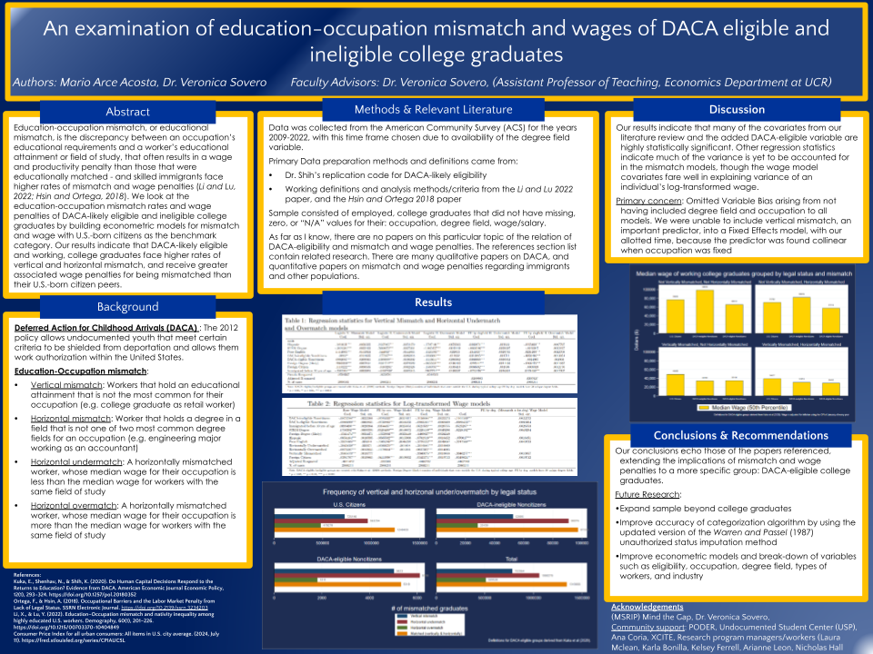
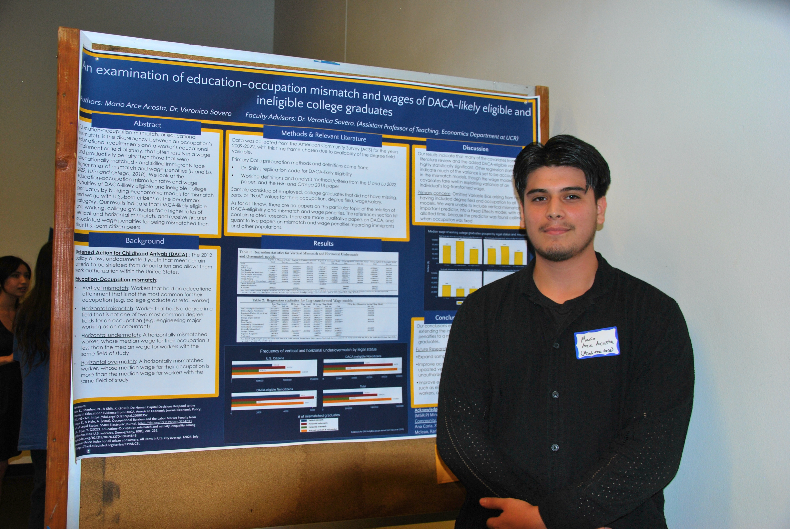
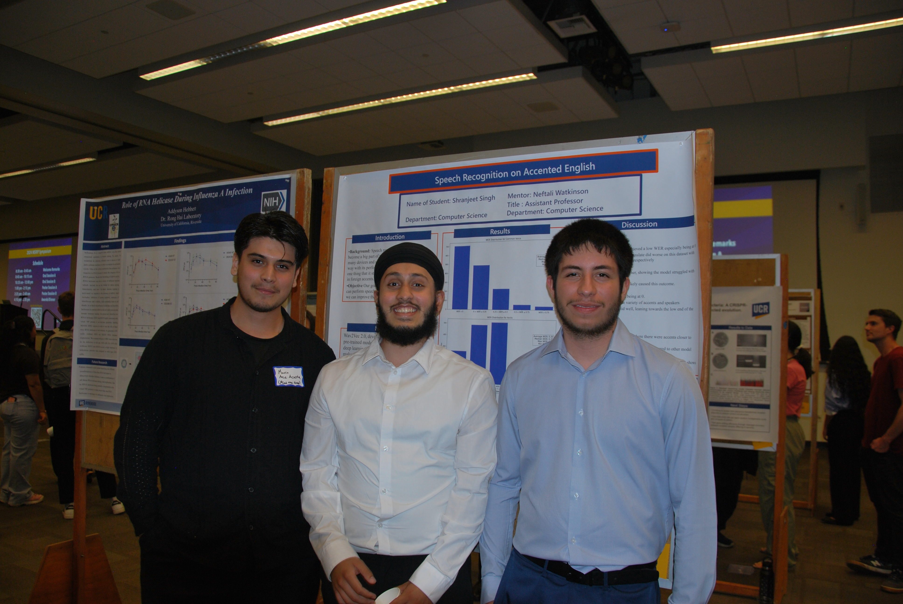
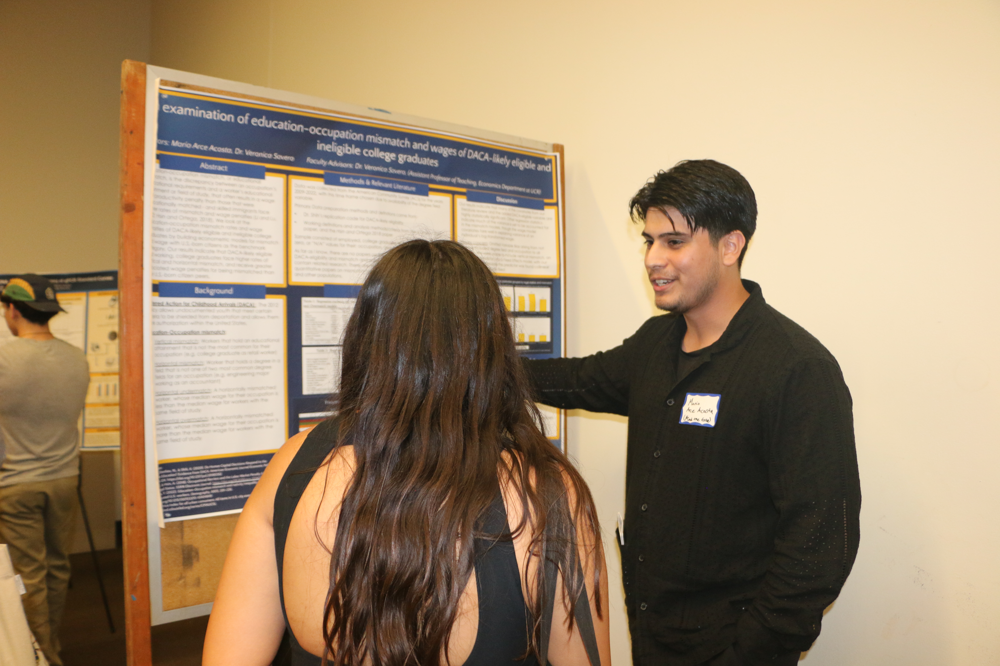

{group="my-gallery" width="50%" fig-align="center"}

# 2026 Peter Hall and Bob Shumway Memorial Conference

Davis, CA — May 23, 2026

{group="my-gallery" width="50%" fig-align="center"}

# 2025 Population Association of America Conference

Washington, D.C. — April 12, 2025

## Abstract

This study estimates the extent of education–occupation mismatch and the associated wage penalties for undocumented college graduates. Using data from the American Community Survey (ACS), we classify workers as vertically mismatched (higher educational attainment than is typical for the occupation) or horizontally mismatched (field of degree is not typical for the occupation). Because the ACS does not identify undocumented status, we train machine learning models on the Survey of Income and Program Participation (SIPP) and use the predictions to impute status in the ACS. This approach enables new analyses of labor market outcomes for undocumented college graduates in nationally representative surveys. Results indicate that undocumented status is linked to higher rates of both vertical and horizontal mismatch, as well as wage penalties of roughly 4–7 percent. These penalties are smaller among the DACA-eligible and in states with more inclusive immigrant policy climates.

## Slides

<iframe class="slide-deck" src="files/PAA_2025_Presentation.pdf" width="100%" height="500px" style="border: 1px solid #ccc;">

</iframe>

[<i class="bi bi-file-earmark-pdf"></i> Download PDF](files/PAA_2025_Presentation.pdf){.btn .btn-primary}

# 2025 Association for Public Policy and Analysis Management Conference

Seattle, WA — November 14, 2025

## Abstract

This study estimates the extent of education–occupation mismatch and the associated wage penalties for undocumented college graduates. Using data from the American Community Survey (ACS), we classify workers as vertically mismatched (higher educational attainment than is typical for the occupation) or horizontally mismatched (field of degree is not typical for the occupation). Because the ACS does not identify undocumented status, we train machine learning models on the Survey of Income and Program Participation (SIPP) and use the predictions to impute status in the ACS. This approach enables new analyses of labor market outcomes for undocumented college graduates in nationally representative surveys. Results indicate that undocumented status is linked to higher rates of both vertical and horizontal mismatch, as well as wage penalties of roughly 4–7 percent. These penalties are smaller among the DACA-eligible and in states with more inclusive immigrant policy climates.

## Slides

<iframe class="slide-deck" src="files/APPAM_2025_Presentation.pdf" width="100%" height="500px" style="border: 1px solid #ccc;">

</iframe>

[<i class="bi bi-file-earmark-pdf"></i> Download PDF](files/APPAM_2025_Presentation.pdf){.btn .btn-primary}

# 2024 Mind the Gap (MSRIP) UC Riverside summer research symposium

Riverside, CA — August 21, 2024

::: {layout-ncol="2"}
{group="my-gallery"}

{group="my-gallery"}

{group="my-gallery"}

{group="my-gallery"}
:::

We used an extract from the American Community Survey (ACS) and Stata's statistical software to examine educational mismatch rates of DACA eligible college graduates and the wage penalty they receive for their legal status.
